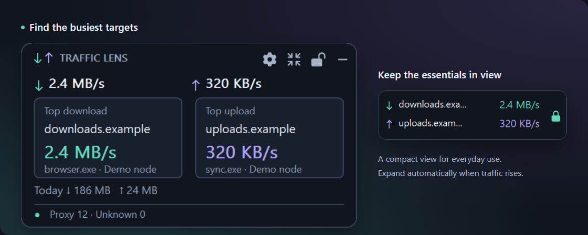

<p align="center"></p>
<h1 align="center">Traffic Lens</h1>
<p align="center"><strong>Find what's using your proxy bandwidth.</strong></p>
<p align="center">A Windows desktop overlay for Clash Verge / Mihomo</p>
<p align="center">
  <a href="https://github.com/onlielll/traffic-lens/releases/tag/v2.0.0"></a>
  
  <a href="LICENSE"></a>
</p>
<p align="center">
  <strong><a href="https://github.com/onlielll/traffic-lens/releases/download/v2.0.0/TrafficLens-2.0.0-win-x64-setup.exe">Download for Windows x64</a></strong> ·
  <a href="https://github.com/onlielll/traffic-lens/releases/download/v2.0.0/TrafficLens-2.0.0-win-x64-portable.zip">Portable ZIP</a> ·
  <a href="README.md">简体中文</a>
</p>



When traffic spikes, see the busiest download and upload targets, their domains or IPs, proxy nodes, and available process names. Open daily rankings to review usage later.

- **Find the source** — Separate download and upload leaders, grouped by domain or ranked by connection.
- **Keep it in view** — A compact overlay with threshold-based expansion, edge snapping, locking, and click-through.
- **Keep records local** — Daily usage retained for 30 days, with rankings for today and the past seven days. No traffic records uploaded.

## Download

**Current release: v2.0.0 public preview.** Both installers and portable packages include the runtime. No separate .NET installation is needed.

| Architecture | Installer | Portable |
| --- | --- | --- |
| **Intel / AMD 64-bit (most PCs)** | [Windows x64](https://github.com/onlielll/traffic-lens/releases/download/v2.0.0/TrafficLens-2.0.0-win-x64-setup.exe) | [ZIP](https://github.com/onlielll/traffic-lens/releases/download/v2.0.0/TrafficLens-2.0.0-win-x64-portable.zip) |
| 32-bit Windows | [Windows x86](https://github.com/onlielll/traffic-lens/releases/download/v2.0.0/TrafficLens-2.0.0-win-x86-setup.exe) | [ZIP](https://github.com/onlielll/traffic-lens/releases/download/v2.0.0/TrafficLens-2.0.0-win-x86-portable.zip) |
| Windows on ARM | [Windows ARM64](https://github.com/onlielll/traffic-lens/releases/download/v2.0.0/TrafficLens-2.0.0-win-arm64-setup.exe) | [ZIP](https://github.com/onlielll/traffic-lens/releases/download/v2.0.0/TrafficLens-2.0.0-win-arm64-portable.zip) |

Installers install for the current user. For portable use, extract the folder and run `ProxyTrafficFloat.exe`.

Targets Windows 10 / 11. Tested on Windows 11 x64 and its x86 compatibility environment; Windows 10, physical 32-bit devices, and ARM64 hardware testing are pending. [Test coverage and memory measurements](docs/VALIDATION.md) · [Release notes and checksums](https://github.com/onlielll/traffic-lens/releases/tag/v2.0.0)

## Quick start

1. **Open Clash Verge or Mihomo** and keep its core running.
2. **Launch Traffic Lens.** It discovers the local Mihomo API automatically.
3. **Check the overlay.** Download and upload leaders appear side by side. Open Settings from the tray to view usage records or choose your metrics.

<details>
<summary>How do I connect manually?</summary>

In Connection & startup, enter the local Mihomo HTTP address, such as `http://127.0.0.1:9090`, or a named pipe. Add the API secret if required. The address and secret must match your client's current configuration.

</details>

## Overlay and preferences

Drag an empty area to move the overlay; it snaps near screen edges. The toolbar opens Settings, switches between detail and mini views, locks, or hides the window. The lock button and tray remain available when click-through is enabled.

- **Choose your metrics:** toggle total speeds, upload/download leaders, daily totals, and target totals individually.
- **Adjust the overlay:** opacity, scale, position locking, click-through, and always-on-top behavior.
- **Expand automatically:** by default, a download leader at 1 MB/s or an upload leader at 512 KB/s for two seconds expands the overlay. Both staying below half their thresholds for ten seconds collapses it. Thresholds and delays are configurable.
- **Use it daily:** Chinese/English, tray controls, and optional startup with Windows. Hiding the overlay or closing Settings keeps monitoring active; exiting from the tray stops it.

<details>
<summary>View Settings</summary>


</details>

## Measurement and privacy

Traffic Lens reads the local Mihomo API. Final DIRECT connections and unknown routes are excluded. Sampling runs once per second; displayed speeds average the last three seconds.

**Observed totals measure usage seen while the monitor is running and help identify traffic sources.** Short connections and disconnected periods may be missed, so these totals are not billing figures. Process details depend on Mihomo; HTTPS connections do not identify downloaded files.

Settings and statistics are stored in `%LOCALAPPDATA%\ProxyTrafficFloat`; API secrets use Windows DPAPI encryption. Traffic Lens does not upload statistics or change Clash routing rules. Uninstalling preserves local settings and records.

## Feedback and contributing

Report problems in [Issues](https://github.com/onlielll/traffic-lens/issues) with the app version, Windows version, Clash/Mihomo client, and steps to reproduce. Redact API secrets, subscription URLs, and private connections from screenshots.

<details>
<summary>Build from source</summary>

Requires Windows and .NET 10 SDK. Installer builds also require Inno Setup 6.

```powershell
.\build.ps1 -Runtime win-x64 -Test
.\scripts\package.ps1 -Runtime win-x64 -IncludeSource
```

Use `win-x86` or `win-arm64` for other architectures. Outputs go to `dist/`.

</details>

[Contributing](CONTRIBUTING.md) · [Changelog](CHANGELOG.md) · [Validation](docs/VALIDATION.md)

---

Copyright © 2026 **onlielll** · [MIT](LICENSE) · [Third-party licenses](THIRD-PARTY-NOTICES.md)
