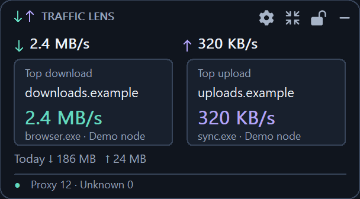
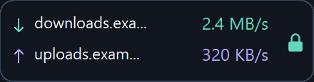
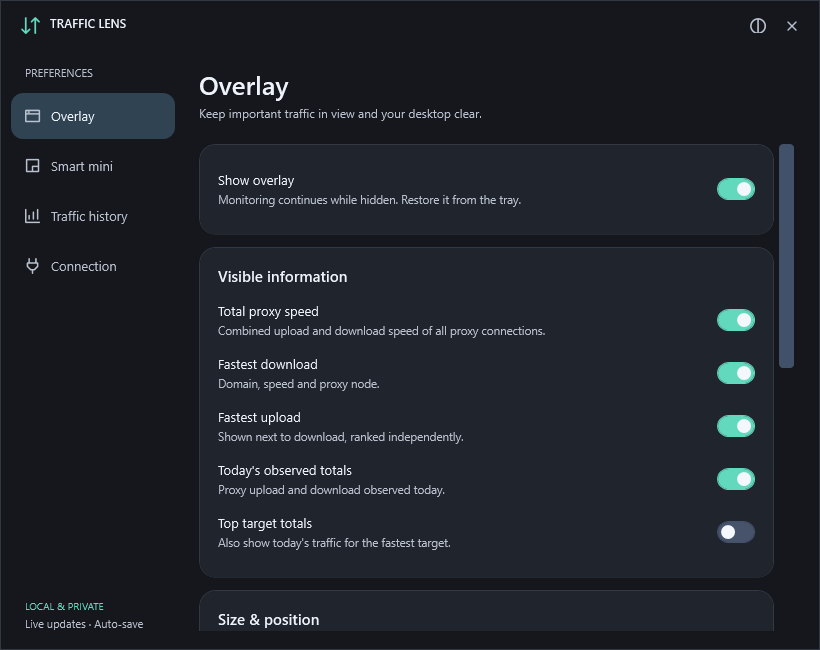
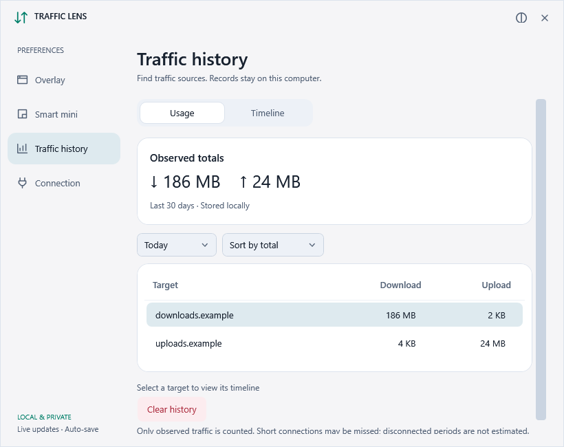
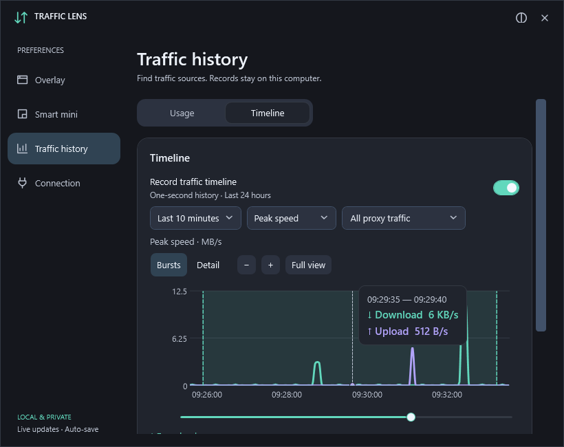

<p align="center"></p>
<h1 align="center">Traffic Lens</h1>
<p align="center"><strong>A Windows overlay for Mihomo proxy traffic</strong></p>
<p align="center"><a href="https://github.com/onlielll/traffic-lens/releases">Download</a> · <a href="#quick-start">Quick start</a> · <a href="README.md">简体中文</a></p>
<p align="center"><a href="https://github.com/onlielll/traffic-lens/actions/workflows/release.yml"></a> <a href="LICENSE"></a></p>

Traffic Lens displays proxy upload and download speeds, the busiest targets, and daily usage on your Windows desktop. It reads Mihomo's local API and works with clients such as Clash Verge.

<table>
<tr>
<td width="60%" valign="top"><strong>Detail view</strong><br><br></td>
<td width="40%" valign="top"><strong>Mini view</strong><br><br></td>
</tr>
</table>

## Features

- **Live rankings** — Separate download and upload leaders, grouped by domain or ranked by connection, with available node and process details.
- **Daily usage** — Domain rankings for today and the past seven days, with 30-day retention by default.
- **Traffic timeline** — Keep the last 24 hours at one-second resolution for all proxy traffic or a domain/IP. A 10-minute view by default, with peak speed, average speed and usage-per-minute modes, smooth curves, hover details, zoom/pan and interval totals.
- **Overlay controls** — Drag, snap to edges, lock, and enable click-through. Adjust opacity, scale, and always-on-top behavior.
- **Automatic mini mode** — Keep key speeds visible and expand when traffic exceeds your thresholds.
- **Preferences** — Choose displayed metrics, light/dark/system appearance, Chinese or English, tray controls, and optional startup with Windows.

<details>
<summary>Settings and timeline</summary>







</details>

## Download

Choose an installer or portable package from [Releases](https://github.com/onlielll/traffic-lens/releases).

| Architecture | File identifier |
| --- | --- |
| Intel / AMD 64-bit | `win-x64` |
| 32-bit Windows | `win-x86` |
| Windows on ARM | `win-arm64` |

Installers include the runtime and install for the current user without administrator privileges. For portable use, extract the folder and run `ProxyTrafficFloat.exe`.

The distribution targets Windows 10 1607+ and Windows 11. x64 and x86 have been tested on Windows 11; ARM64 hardware testing is pending. See the [validation report](docs/VALIDATION.md).

## Quick start

1. Start Mihomo or Clash Verge.
2. Install and launch Traffic Lens. It discovers the local Mihomo API automatically.
3. If it cannot connect, enter a local HTTP address, such as `http://127.0.0.1:9090`, or a named pipe in Settings, along with the API secret if required.

Drag an empty area to move the overlay. Use the toolbar to open Settings, change view, lock, or hide it. Click the mini view to expand temporarily; the lock button and tray remain available with click-through enabled.

By default, the overlay expands when the download leader reaches 1 MB/s or the upload leader reaches 512 KB/s for two seconds. It collapses after both stay below half their thresholds for ten seconds. Thresholds and delays are configurable.

Use the tray to show, hide, or exit. Closing Settings leaves monitoring active. Change language in Connection & startup; use the title-bar appearance button for light, dark or system appearance. The default follows Windows.

## Measurement and privacy

Traffic Lens reads only the local Mihomo API. Final DIRECT connections and unknown routes are excluded from proxy totals. Connections are sampled once per second; displayed speeds average the last three seconds.

Traffic history has Usage and Timeline tabs. Select a target in Usage to open its chart. Scroll normally to move the page; use Ctrl + scroll or the +/− buttons to zoom. Timeline recording is off by default; enable it in the Timeline tab. Complete second-level records roll over after 24 hours; daily rankings retain 30 days. Bursts view avoids magnifying tiny traffic into full-height spikes; Detail fits the scale to low rates. The chart aggregates only the visible range, preserves rate peaks in peak mode, and restores second-level detail when zoomed in. Selected interval totals use recorded bytes rather than the interpolated curve. Timestamps are local; unmonitored periods remain gaps. Older minute records retain their original precision.

Core online means the API is reachable. After system proxy and TUN are turned off, the three-second average may briefly persist; daily totals remain.

Observed totals cover increments seen while monitoring. Short connections and disconnected periods may be missed. Process information depends on Mihomo, and HTTPS connections do not identify the downloaded file.

Settings and statistics are stored in `%LOCALAPPDATA%\ProxyTrafficFloat`; API secrets use Windows DPAPI encryption. Traffic Lens does not upload statistics or change routing rules. Uninstalling preserves local settings and records.

## Development

Requires Windows and .NET 10 SDK. Installer builds also require Inno Setup 6.

```powershell
.\build.ps1 -Runtime win-x64 -Test
.\scripts\package.ps1 -Runtime win-x64 -IncludeSource
```

Use `win-x86` or `win-arm64` for other architectures. Outputs go to `dist/`; GitHub Actions builds all three architectures.

[Contributing](CONTRIBUTING.md) · [Changelog](CHANGELOG.md) · [Validation](docs/VALIDATION.md)

## License

Copyright © 2026 **onlielll** · [MIT](LICENSE)

Charts use [OxyPlot](https://github.com/oxyplot/oxyplot); toolbar icons use [Heroicons](https://github.com/tailwindlabs/heroicons). See [third-party notices](THIRD-PARTY-NOTICES.md) for bundled component licenses.
