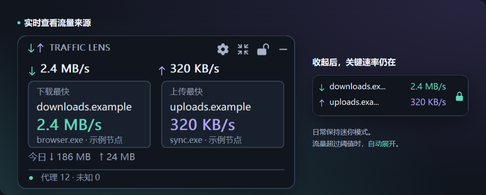

<p align="center"></p>
<h1 align="center">Traffic Lens</h1>
<p align="center"><strong>找出谁在消耗代理流量。</strong></p>
<p align="center">Windows 桌面悬浮窗 · 适用于 Clash Verge / Mihomo</p>
<p align="center">
  <a href="https://github.com/onlielll/traffic-lens/releases/tag/v2.1.0"></a>
  
  <a href="LICENSE"></a>
</p>
<p align="center">
  <strong><a href="https://github.com/onlielll/traffic-lens/releases/download/v2.1.0/TrafficLens-2.1.0-win-x64-setup.exe">下载 Windows x64 安装包</a></strong> ·
  <a href="https://github.com/onlielll/traffic-lens/releases/download/v2.1.0/TrafficLens-2.1.0-win-x64-portable.zip">便携版</a> ·
  <a href="README.en.md">English</a>
</p>



流量突然增加时，直接查看下载与上传最快的域名、IP、代理节点及可获取的进程；想回看用量，再打开每日排行。

- **看清来源** — 下载、上传分别排行，支持按域名合并或按单连接查看。
- **留在桌面** — 迷你窗保留关键速率，流量超过阈值时自动展开；支持吸附、锁定与点击穿透。
- **记录留在本机** — 每日用量保存 30 天，查看今天与近七天排行，无需上传流量记录。

## 下载

**当前版本：v2.1.0 预览版。** 安装包与便携版均已包含运行环境，无需另装 .NET。

| 电脑架构 | 安装包 | 便携版 |
| --- | --- | --- |
| **Intel / AMD 64 位（通常选这个）** | [Windows x64](https://github.com/onlielll/traffic-lens/releases/download/v2.1.0/TrafficLens-2.1.0-win-x64-setup.exe) | [ZIP](https://github.com/onlielll/traffic-lens/releases/download/v2.1.0/TrafficLens-2.1.0-win-x64-portable.zip) |
| 32 位 Windows | [Windows x86](https://github.com/onlielll/traffic-lens/releases/download/v2.1.0/TrafficLens-2.1.0-win-x86-setup.exe) | [ZIP](https://github.com/onlielll/traffic-lens/releases/download/v2.1.0/TrafficLens-2.1.0-win-x86-portable.zip) |
| Windows on ARM | [Windows ARM64](https://github.com/onlielll/traffic-lens/releases/download/v2.1.0/TrafficLens-2.1.0-win-arm64-setup.exe) | [ZIP](https://github.com/onlielll/traffic-lens/releases/download/v2.1.0/TrafficLens-2.1.0-win-arm64-portable.zip) |

安装包为当前用户安装；便携版解压后运行 `ProxyTrafficFloat.exe`。

面向 Windows 10 / 11。已在 Windows 11 验证 x64 与 x86 兼容环境；Windows 10、真实 32 位设备及 ARM64 尚待实测。[测试范围与内存实测](docs/VALIDATION.md) · [版本说明与校验文件](https://github.com/onlielll/traffic-lens/releases/tag/v2.1.0)

## 快速开始

1. **打开 Clash Verge 或 Mihomo**，保持内核运行。
2. **启动 Traffic Lens**，自动发现本机 Mihomo 接口。
3. **查看悬浮窗**：下载、上传最快目标并排显示；从托盘打开设置，查看流量记录或调整展示内容。

<details>
<summary>连接失败时，如何手动设置？</summary>

在“连接与启动”中填写 Mihomo 本地 HTTP 地址（例如 `http://127.0.0.1:9090`）或命名管道；有接口密钥时一并填写。地址与密钥需和客户端当前配置一致。

</details>

## 时间线与数据

开启时间线后，完整秒级记录滚动保留最近 24 小时。支持按域名/IP 查看，切换速率与每分钟用量；Ctrl + 滚轮缩放、滑块平移，点击时间轴两处查看区间上下行总量。平滑曲线保留峰值，未监测时段留空。

<details>
<summary>查看时间线</summary>


</details>

可导出 CSV 或备份本机数据库。在设置中填写剩余额度后，按最近 7 个有记录日的平均用量估算可用天数；其他设备、离线流量及套餐倍率未计入。

## 悬浮窗与设置

拖动空白区域移动窗口，靠近屏幕边缘自动吸附。顶部按钮用于设置、详细/迷你模式、锁定与隐藏；点击穿透后，仍可通过小锁或托盘解锁。

- **按需展示**：总速度、上下行最快目标、今日累计与目标累计分别开关。
- **调整外观**：透明度、界面大小、锁定位置、鼠标穿透与始终置顶。
- **自动展开**：默认下载最快目标达到 1 MB/s 或上传最快目标达到 512 KB/s，持续 2 秒展开；低于阈值一半持续 10 秒后收起。均可调整。
- **更多选择**：跟随系统的浅色/深色外观、全屏应用自动隐藏、四角拖动调整大小，以及节点延迟曲线和慢节点提示。延迟默认读取 Mihomo 已有结果，主动测速独立开关。
- **日常使用**：中英文切换、托盘控制与可选开机启动。隐藏悬浮窗或关闭设置后仍继续监控，从托盘退出才停止。

<details>
<summary>查看设置界面</summary>


</details>

## 统计口径与隐私

流量采样读取本机 Mihomo 接口，最终直连（DIRECT）与未知链路不计入代理流量。每秒采样，速率显示最近三秒平均值。

**“监测累计”是软件运行期间观测到的用量，用于定位流量来源。** 短连接与断线期间可能漏记，不作为套餐计费依据；进程信息取决于 Mihomo，HTTPS 连接无法识别具体下载文件。

设置与统计保存在 `%LOCALAPPDATA%\ProxyTrafficFloat`，接口密钥使用 Windows DPAPI 加密。不上传统计、不修改 Clash 分流规则。手动检查更新访问 `api.github.com`，下载页在 GitHub 打开；主动测速开启后由 Mihomo 发起外网请求。卸载保留本机设置与记录。

## 反馈与贡献

遇到问题请提交 [Issue](https://github.com/onlielll/traffic-lens/issues)，附上软件版本、Windows 版本、Clash/Mihomo 客户端，以及复现步骤。截图前请遮盖接口密钥、订阅地址和私人连接信息。

<details>
<summary>从源码构建</summary>

需要 Windows 与 .NET 10 SDK；生成安装包另需 Inno Setup 6。

```powershell
.\build.ps1 -Runtime win-x64 -Test
.\scripts\package.ps1 -Runtime win-x64 -IncludeSource
```

其他架构使用 `win-x86` 或 `win-arm64`，输出位于 `dist/`。

</details>

[贡献说明](CONTRIBUTING.md) · [更新记录](CHANGELOG.md) · [验证报告](docs/VALIDATION.md)

---

Copyright © 2026 **onlielll** · [MIT](LICENSE) · [第三方许可](THIRD-PARTY-NOTICES.md)
