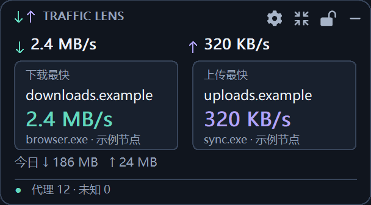
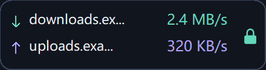
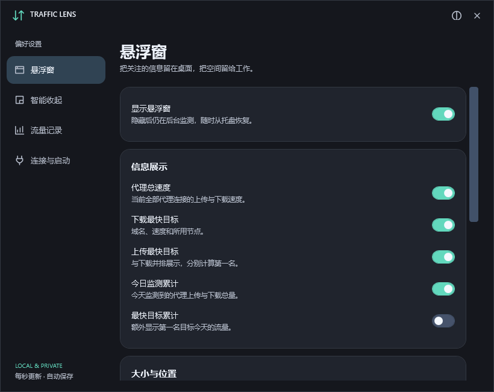
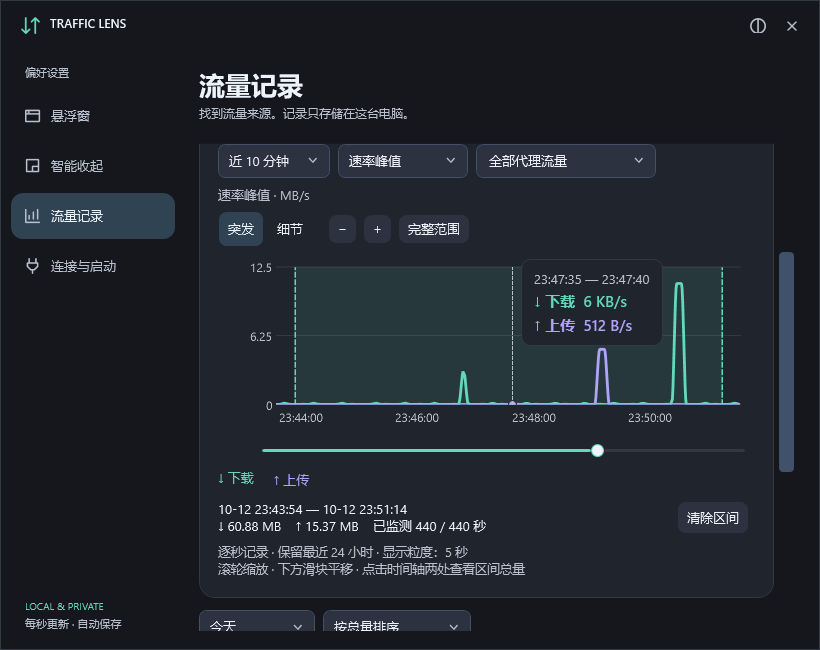

<p align="center"></p>
<h1 align="center">Traffic Lens</h1>
<p align="center"><strong>Mihomo 代理流量监控悬浮窗</strong></p>
<p align="center"><a href="https://github.com/onlielll/traffic-lens/releases">下载</a> · <a href="#快速开始">快速开始</a> · <a href="README.en.md">English</a></p>
<p align="center"><a href="https://github.com/onlielll/traffic-lens/actions/workflows/release.yml"></a> <a href="LICENSE"></a></p>

Traffic Lens 在 Windows 桌面显示代理上下行速率、当前下载与上传最快的目标，并记录每日域名用量。通过 Mihomo 本地接口读取数据，适用于 Clash Verge 等使用 Mihomo 的客户端。

<table>
<tr>
<td width="60%" valign="top"><strong>详细模式</strong><br><br></td>
<td width="40%" valign="top"><strong>迷你模式</strong><br><br></td>
</tr>
</table>

## 核心功能

- **实时排行**：分别显示下载和上传最快的目标，支持域名合并或单连接排行，展示可获取的节点与进程信息。
- **每日统计**：查看今天、近七天的域名用量排行，默认保留 30 天记录。
- **流量时间线**：逐秒保存最近 24 小时的代理总量和域名/IP记录；默认近 10 分钟的平滑曲线，支持峰值、平均速率与每分钟用量；悬停详情、滚轮缩放、滑块平移，以及两点区间总量。
- **悬浮窗控制**：拖动、边缘吸附、锁定与点击穿透，可调整透明度、缩放和置顶状态。
- **自动收起与展开**：迷你模式保留关键速率，超过设定阈值后自动展开。
- **个性化设置**：展示内容独立开关；浅色、深色与跟随系统主题，支持中文、英文、托盘控制与可选开机启动。

<details>
<summary>设置与时间线</summary>





</details>

## 下载

在 [Releases](https://github.com/onlielll/traffic-lens/releases) 下载对应架构的安装包或便携包。

| 电脑架构 | 文件标识 |
| --- | --- |
| Intel / AMD 64 位 | `win-x64` |
| 32 位 Windows | `win-x86` |
| Windows on ARM | `win-arm64` |

安装包包含运行环境，为当前用户安装，无需管理员权限。便携包解压后运行 `ProxyTrafficFloat.exe`。

运行目标为 Windows 10 1607+ 和 Windows 11。x64、x86 已在 Windows 11 上验证，ARM64 尚待设备实测。详细结果见 [验证报告](docs/VALIDATION.md)。

## 快速开始

1. 启动 Mihomo 或 Clash Verge。
2. 安装并运行 Traffic Lens，软件会自动发现本机 Mihomo 接口。
3. 如果连接失败，在设置中填写本机 HTTP 地址（如 `http://127.0.0.1:9090`）或命名管道，并按需输入接口密钥。

拖动空白区域移动窗口；顶部按钮用于设置、模式切换、锁定和隐藏。点击迷你窗可临时展开，开启点击穿透后可通过小锁或托盘解锁。

默认自动展开条件：下载最快目标达到 1 MB/s，或上传最快目标达到 512 KB/s，持续 2 秒；低于阈值一半持续 10 秒后收起。阈值与延时可在设置中调整。

从托盘显示、隐藏或退出。关闭设置页后仍继续监控；语言在“连接与启动”中切换。设置标题栏的外观按钮切换主题，默认跟随 Windows。

## 统计与隐私

只读取本机 Mihomo 接口，最终 DIRECT 的连接与未知链路不计入代理流量。速度每秒采样，显示最近三秒的平均值。

时间线记录默认关闭，可在流量记录页开启。完整秒级记录滚动保留 24 小时，每日排行继续保留 30 天。“突发”视图避免把小流量撑满纵轴，“细节”视图可放大低速变化。图表按可见范围聚合，峰值模式保留区间内的最大速率，放大后恢复秒级细节；区间总量来自原始记录，不按曲线估算。时间以本地时间显示，断线和未记录时段留空，旧分钟记录保留原精度。

“内核在线”表示本机接口可访问。关闭系统代理和 TUN 后，三秒平均可能短暂残留，每日累计不会归零。

累计量仅覆盖监测期间观测到的增量，可能遗漏短连接及断线期间的流量，适合定位流量来源。进程信息取决于 Mihomo；HTTPS 连接无法识别具体下载文件。

设置与统计存储在 `%LOCALAPPDATA%\ProxyTrafficFloat`，接口密钥由 Windows DPAPI 加密。软件不上传统计、不修改分流规则。卸载后保留本机设置与记录。

## 开发

需要 Windows 与 .NET 10 SDK；生成安装包还需要 Inno Setup 6。

```powershell
.\build.ps1 -Runtime win-x64 -Test
.\scripts\package.ps1 -Runtime win-x64 -IncludeSource
```

其他架构使用 `win-x86` 或 `win-arm64`。输出位于 `dist/`，GitHub Actions 支持三个架构的自动构建。

[贡献说明](CONTRIBUTING.md) · [更新记录](CHANGELOG.md) · [验证报告](docs/VALIDATION.md)

## 许可证

Copyright © 2026 **onlielll** · [MIT](LICENSE)

时间曲线使用 [OxyPlot](https://github.com/oxyplot/oxyplot)，工具栏使用 [Heroicons](https://github.com/tailwindlabs/heroicons)。随包组件的许可见 [第三方说明](THIRD-PARTY-NOTICES.md)。
